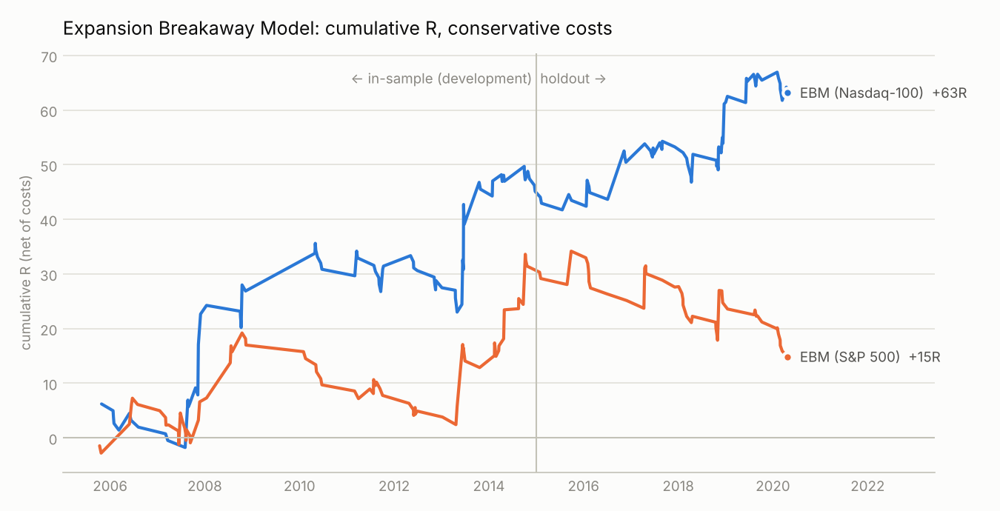

# ICT, tested: the Expansion Breakaway Model

A reproducible research lab that turns Inner Circle Trader (ICT) concepts into
exact rules and tests them on 15 years of 1-minute data. It also contains the
one new model that came out of the research: the **Expansion Breakaway Model
(EBM)**.

## The honest headline

- **Textbook ICT setups lose money once they're made mechanical.** The
  "2022 model" (sweep → market-structure shift → FVG) lost about 1,000R over
  3,000 Nasdaq-100 trades, 2005–2020. Silver Bullet, power of three, SMT filters
  and the daily-bias heuristics show no edge either, on Nasdaq-100, S&P 500,
  EUR/USD, GBP/USD or gold.
- **The best new model, EBM, is a lead, not a proven money machine.** It trades
  ICT's breakaway FVG only when daily volatility is expanding. On the untouched
  2015–2020 holdout it made **+0.31R per trade on the Nasdaq-100** (58 trades,
  profit factor 1.45, −7% max drawdown at 1% risk) but **lost on the S&P 500**
  (−0.35R) and on FX and gold. The t-stat is about 1, and three trend days carry
  the Nasdaq profit.
- Nobody can honestly promise "the most profitable model ever". What this repo
  gives you is a model you can forward-test and the evidence to judge it with.



## The model in one screen

Rules for longs; shorts mirror. Full rules, parameters and caveats are in
[docs/MODEL.md](docs/MODEL.md).

1. **Gate:** ATR14 / ATR100 of prior daily ranges ≥ 1.10. Otherwise no trade.
2. **Liquidity map at 09:30 NY:** overnight, previous-day, pre-market, Asia,
   London and previous cash-session highs above the open, within 1.5 ATR.
3. **Run:** 09:30–11:30, price trades through one or more of them.
4. **Breakaway:** a 15m candle closes above the highest run level, and the leg
   left a bullish 15m FVG.
5. **Entry:** limit at the FVG's 50% (CE) until 12:00. Cancel if a 15m candle
   closes back below the level.
6. **Stop:** at the run level (0.05–0.6 ATR, ≥ 2 NQ points).
7. **Exit:** 15:55 NY. One trade a day.

TradingView version: [`pine/expansion_breakaway_model.pine`](pine/expansion_breakaway_model.pine)
(Pine v6 strategy, for NQ/MNQ on 1–5m charts). It hasn't been compiled in
TradingView yet, so expect possible small syntax fixes.

## Results at a glance (conservative costs: NQ 1 pt, ES 0.5 pt per round trip)

| Model | Nasdaq-100, 2005–14 | Nasdaq-100, holdout 2015–20 | S&P 500, holdout |
|---|---|---|---|
| **EBM** (this repo) | +0.58R × 78 | **+0.31R × 58** | −0.35R × 47 |
| ICT 2022 model, mechanized | −0.38R × 1,927 | −0.27R × 1,084 | −0.46R × 995 |
| Silver Bullet, mechanized | −0.35R × 1,019 | −0.17R × 553 | −0.36R × 469 |

How every concept was tested, and what failed: [docs/RESEARCH.md](docs/RESEARCH.md).

## Reproduce

```bash
pip install -r requirements.txt
scripts/fetch_data.sh               # 1-minute Oanda data, 2005-2020 (public GitHub mirror, ~1.2 GB)
python3 scripts/build_data.py       # build the parquet cache
python3 -m pytest -q                # no-lookahead and long/short mirror tests
python3 scripts/run_ebm.py --inst NAS100_USD --start 2015-01-01 --end 2020-06-01
```

## Layout

| Path | What |
|---|---|
| `ictmodel/data.py`, `sessions.py` | Data loading, NY time, Globex days, ICT liquidity levels |
| `ictmodel/structures.py` | FVG, swing points, higher-timeframe aggregation (all causal) |
| `ictmodel/engine.py` | Reversal and continuation state machines, conservative fills, costs |
| `ictmodel/model.py` | The frozen EBM and the pre-registered reference models |
| `ictmodel/metrics.py` | Expectancy, t-stat, profit factor, CAGR, drawdown, Sharpe |
| `research/01…19_*.py` | Every experiment, in order, with outputs in `results/` |
| `results/holdout/` | The one-time 2015–2020 holdout: report, summary, trade lists |
| `pine/` | TradingView strategy |
| `report/` | The HTML results page (`build_report.py` rebuilds it from `results/`) |
| `tests/` | Integrity tests |

## Limits

Oanda CFD mid prices stand in for exchange futures. There's no data after
May 2020, and the strategy can't be checked against 2021–2026 here. That's the
first thing to forward-test. Educational research, not financial advice.
