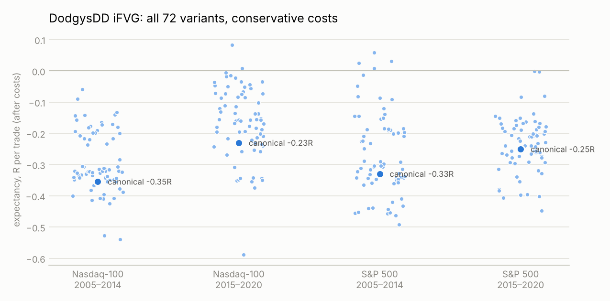

# DodgysDD's iFVG model, mechanized and benchmarked

DodgysDD (Ryan) teaches one core idea with several entry variants: the
**inversion fair value gap (iFVG)**. Liquidity gets swept, price displaces and
leaves a fair value gap, then a candle closes back through that gap. The gap
"inverts" and you trade the new direction.

This page lists where each rule comes from, how it was turned into code, and how
every variant performed on the same data and costs as the rest of this
repository.

## Sources

His videos, X posts, Whop pages and TradingView pages are blocked from this
research environment, so everything below comes from public web material
reachable through search. Each rule is tagged by who said it.

| Tag | Source | What it contributes |
|---|---|---|
| **R** (his own words) | His X thread, via [Thread Reader](https://threadreaderapp.com/thread/1741474644232650862.html) | An iFVG is an FVG that gets closed through; it flips role and counts as a structure shift. He wants one obvious gap, not a stack. A liquidity sweep comes first. **He enters on the candle close through the gap and does not wait for a retrace.** Targets: data highs/lows, old highs/lows, equal highs/lows. **Preferred stop: a close back the other way through the FVG**; the alternative is beyond the old high/low. |
| **R** | [iFVG Ultimate+ \| DodgysDD](https://www.tradingview.com/script/JOUhqb85-iFVG-Ultimate-DodgysDD/) (TradingView listing) | The sequence: sweep of a prior swing high/low → displacement with a body-to-body gap → a full candle body closes through the gap after the raid. Asia (20:00–00:00) and London (02:00–05:00) session levels. |
| **R** | Rating sheet copies ([Scribd](https://www.scribd.com/document/752135817/Dodgy-s-IFVG-Setups-Rating), [Studocu](https://www.studocu.com/en-us/document/los-angeles-trade-technical-college/preemployment-applied-trades/dodgys-ifvg-setups-rating-liquidity-sweep-delivery-analysis/137339969)), [Whop guide](https://whop.com/dodgys-dungeon/) | A+: higher-timeframe sweep, clean iFVG, liquidity to draw on, premium/discount, and "delivery from another FVG". A: one piece missing. B: no major sweep or FVG delivery. C: "middle of nowhere". |
| **R** | [iFVG Ultimate+ Deluxe](https://www.tradingview.com/script/LOmpLchd-iFVG-Ultimate-Deluxe-DodgysDD/) | Grade = count of up to six criteria: liquidity sweep, HTF FVG delivery, volume-delta imbalance, the inversion itself, clear targets, SMT. |
| **P** (partner) | [Taking Prophets docs](https://docs.takingprophets.com/partners/dodgysdd/ifvg-ultimate/) (the indicator's developer) | Detection Single (default) or Series; sensitivity by ATR (Sensitive / Normal / Strict); bias filter; minimum grade. |
| **T** (third party) | [cantolab/IFVG-Ultimate-Dodgy](https://github.com/cantolab/IFVG-Ultimate-Dodgy) (open-source rebuild, MIT) | The concrete mechanics: a 3-bar swing starts the leg; the most extreme single FVG of the leg is the candidate; it must invert within 15 candles (7–15 allowed by Dodgy, 6 otherwise); entry at the inversion close; stop at the wick, body or iFVG; break-even line at the leg's origin swing; HTF mapping 1m→15m, 5m→60m. Its author also says Dodgy keeps sensitivity at the most sensitive setting, and that the original indicator hides setups that hit the stop before break-even. |
| **T** | [Dodgy's Dungeon write-up](https://dodgys-dungeon-promo-code.mintlify.app/features/ifvg-strategy), reviews ([fromzerototrader](https://fromzerototrader.com/ifvg-ultimate-by-dodgysdd-is-this-tradingview-indicator-worth-40-a-month/), [Stock Dork](https://www.thestockdork.com/dodgys-dungeon-review/)) | Entries only in London and New York killzones; 1–3m iFVGs after an H1 sweep; trades NQ, ES and forex. |
| **T** | [Flux Charts](https://www.fluxcharts.com/articles/inversion-fair-value-gaps-ifvg-explained) | Stop below the iFVG, 1:2 risk-reward (a generic summary, not his rule). |

## Rules as coded

`ictmodel/engine.py::_long_ifvg`, presets in `ictmodel/model.py::dodgy`. Rules
are for longs; shorts are the exact mirror.

| Step | Rule | From |
|---|---|---|
| Leg | A 3-bar swing high (on the chart timeframe) starts a down leg; a 3-bar swing low later freezes it, and a new low unfreezes it. | T |
| Gap | Bearish FVGs inside the leg; the lowest single one is the candidate ("Single" detection). | R, P, T |
| Inversion | A chart-timeframe candle closes above the gap's top within 15 candles of the gap. | R, T |
| No room | Skip if that close is already above the leg's origin high (the break-even line). | T |
| Entry | Market at the inversion close. | R |
| Grade | `all`: every iFVG. `sweep` (A+ core): a higher-timeframe swing low was swept during the leg. `sweep_htf`: also overlaps a live HTF FVG. | R, T |
| Sessions | `kz`: confirmations in London 02:00–05:00 or New York 08:30–11:00. `ny`: 09:30–15:30. | T, R |
| Stop | `close`: exit when a candle closes back below the gap, with a hard stop at the leg's wick low. `wick`: hard stop at that low. | R, T |
| Target | `liq`: nearest liquidity at least 1R away (origin high, untouched session highs, running high), capped at 5R, else 2R. `rr`: 2R. `rr_be`: 2R with the stop moved to entry once the origin high trades. | R, T |
| Housekeeping | Up to 3 trades a day, one at a time, flat at 15:55. Stop at least 2 NQ points / 1 ES point (the same cost floor as EBM). Costs NQ 1.0 / ES 0.5 points per round trip. | ours |

**Canonical version** (closest to how he describes it, fixed before any result):
1-minute chart, A+ sweep grade, killzones, close-back stop, liquidity target.

**Left out, and why.** The ATR thresholds behind "Normal" and "Strict" sensitivity
aren't published, and the rebuild's author says Dodgy uses the most sensitive
setting, so no gap-size filter is applied. Volume delta and SMT are Deluxe extras he
trades without. Premium/discount has no published definition. Discretion ("I
wouldn't have taken that one") can't be coded.

## Results

All runs use 2005–2014 and the 2015–2020 holdout, Oanda 1-minute mid prices, and the
same conservative fills as the rest of the repo. Nothing was tuned: the canonical
version was fixed in `ictmodel/model.py` before the first run, and all 72 variants
are in `results/dodgysdd/summary.csv`.

### Canonical (1m, A+ sweep, killzones, close-back stop, liquidity target)

| Market | Period | Trades | Win % | Expectancy, 1-pt / 0.5-pt costs | Before costs | t | Profit factor |
|---|---|---:|---:|---:|---:|---:|---:|
| Nasdaq-100 | 2005–2014 | 3,746 | 24 | −0.35R / −0.20R | −0.045R | −17.2 | 0.53 |
| Nasdaq-100 | 2015–2020 | 3,066 | 22 | −0.23R / −0.12R | −0.004R | −9.8 | 0.65 |
| S&P 500 | 2005–2014 | 3,309 | 25 | −0.33R / −0.18R | −0.031R | −13.8 | 0.58 |
| S&P 500 | 2015–2020 | 2,464 | 27 | −0.25R / −0.12R | +0.021R | −8.7 | 0.67 |

(S&P costs are 0.5 / 0.25 points.) That's about two trades a day, mostly between
09:00 and 11:00 and in London. Long and short behave the same.

### All 72 variants

Positive variants: Nasdaq-100 0 of 72 (2005–14) and 2 of 72 (2015–20);
S&P 500 4 of 72 (2005–14) and 0 of 72 (2015–20). Five of those six are 5-minute
"A+ with HTF FVG" killzone variants with only 10 trades each; the sixth made +0.007R.
None is positive in the other period.

### Why it loses

- **No edge before costs.** Gross expectancy is between −0.045R and +0.02R in every
  canonical run, a coin flip with a 2:1-ish payoff and a ~25% hit rate.
- **Costs dominate.** Median 1-minute stops are 1.7–4.8 points, so a round trip costs
  0.2–0.3R before the trade starts. 5-minute setups lose less for that reason, but still lose.
- **The A+ filter helps a little.** Requiring a higher-timeframe sweep lifts
  expectancy by 0.05–0.13R versus taking every iFVG, but doesn't make it positive.
  Adding HTF FVG overlap cuts trades by 92–96% without a consistent improvement.

This matches what the open-source rebuild's author reported from watching the
indicator in real time: with losing setups shown instead of hidden, iFVGs work about
as often as chance. It also matches this repo's broader finding that 1-minute ICT
entry patterns have no edge after costs.

### Limits

The data ends in May 2020, before Dodgy's model became popular, and is a CFD proxy
for futures. His discretion (skipping setups that "don't look right") can't be
tested. The canonical rules follow his own descriptions as closely as public
sources allow, and every interpretation choice is listed above.
