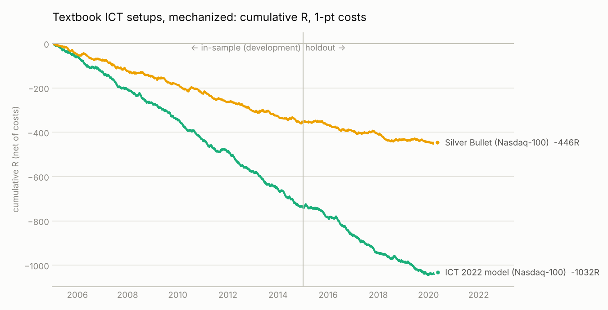
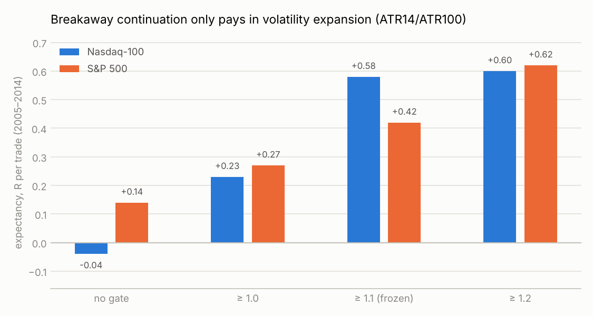

# Research log: do ICT concepts survive a mechanical test?

**Question.** Can "Inner Circle Trader" concepts (liquidity sweeps, market
structure shifts, fair value gaps, killzones, power of three, SMT divergence) be
turned into a mechanical model that makes money after costs on data it has never
seen?

**Short answer.** Not in 15 years of 1-minute data on Nasdaq-100, S&P 500,
EUR/USD, GBP/USD and gold. Every textbook setup lost money. One new combination,
the [Expansion Breakaway Model](MODEL.md), was positive on the Nasdaq-100 holdout
but not on any other market, so it's a lead to forward-test, not a proven edge.

## Data

Oanda M1 **mid-price** candles mirrored in the public
[`FutureSharks/financial-data`](https://github.com/FutureSharks/financial-data)
repository, January 2005 to May 2020: NAS100 (4.3M bars), SPX500 (4.0M), EUR/USD
(5.6M), GBP/USD and XAU/USD. Timestamps were converted from UTC to New York time.
A trading day runs 18:00 → 17:00 (Globex). Regular-session coverage is 375–385 of
390 bars a day for the Nasdaq-100 in every year. Pre-2014 overnight quotes are
thinner, and the S&P 500 has gaps in 2017.

Exchange futures data (CME), Yahoo, Dukascopy, Binance, HistData and Stooq were
all blocked by this environment's network policy. CFD mid prices are a proxy for
NQ/ES: levels and intraday paths match closely, but sweep depths at the tick level
can differ.

## Method

- **Engine** (`ictmodel/engine.py`). Event-driven on 1-minute bars, with structure
  on 1/3/5/15-minute bars built causally (a higher-timeframe bar is only known
  after its last minute). Longs and shorts run the same code: shorts run on
  negated prices, so the two sides can't drift apart.
- **Conservative fills.** Limits need a one-tick trade-through. A stop and target
  inside the same bar count as a stop. A fill bar that also touches the stop is a
  loss. A target can't be hit on the fill bar.
- **Costs.** NQ 1.0 pt / ES 0.5 pt per round trip as the stress case (about 2× a
  futures trader's real commission plus slippage), and 0.5 / 0.25 as "realistic".
  FX 1–1.5 pips, gold $0.40.
- **Integrity tests** (`tests/`). Scrambling every bar after a fill must leave
  that trade's signal, entry, stop and target unchanged (no lookahead), and long
  and short logic must be exact mirrors, on synthetic data and on 300 real days.
  All pass.
- **Discipline.** Development used **2005–2014 only**, and every result was
  checked in both halves (2005–09 and 2010–14). The **2015–2020 holdout** was run
  **once**, after the model and the reference setups were frozen in
  `ictmodel/model.py`. Roughly 1,000 rule/parameter combinations were evaluated
  during development. That's why a single good-looking cell means little, and why
  the holdout matters.

## Findings (development data, 2005–2014)

| ICT concept, mechanized | Script | Result | Verdict |
|---|---|---|---|
| Daily bias from midnight open, previous-day close location, overnight move, gap, 20-day trend | `02_bias_stats.py` | Direction hit rate 43–53%, correlations within ±0.08 | No bias signal |
| Time: when the RTH high/low forms | `01_ict_stats.py` | On up days the low is in by 11:00 on ~78% of days (mirror for down days) | True, but it describes the day after the fact and isn't tradeable alone |
| Liquidity sweep + reclaim (turtle soup) of overnight, previous-day, Asia, London and pre-market levels | `01_ict_stats.py` | −0.11 to +0.19R per level before costs, 30–40% wins on 2R | No edge |
| Sweep → market-structure shift → FVG / IFVG / shift-close entry ("2022 model"), 144 variants (1–15m structure, targets 2R / liquidity / close) | `03_structure_grid.py` | Every variant negative after costs; best −0.11R; ≈0 before costs | No edge; costs dominate on 1–5m |
| + SMT divergence with ES, + stacked liquidity (≥2 levels swept) | `04_smt_stack.py` | No improvement; strict SMT is usually worse | No edge |
| Same reversal model in London and NY killzones on EUR/USD, GBP/USD, gold | `06_fx_reversal.py` | Mostly negative; best EUR/USD London 15m +0.08R (t 1.0) | No edge |
| Breakaway-FVG continuation after a liquidity run, 192 variants | `08_continuation_grid.py` | Negative after costs; slightly positive before costs with stops at the run level | Weak, cost-dominated |
| Daily power of three (AMD) as one trade a day, stop beyond the manipulation extreme, exit at the close | `09_amd_daily.py` | ≈0 before costs at every check time | No edge |
| Market-maker sequence (opposite side raided first, then breakaway) | `14_mmbm_sequence.py` | Worse than without the sequence condition | Not supported |
| London-open "Judas swing" | `15_london_drift.py` | Negative; the London-open drift exists (+1.8–2.3 bps, t 3.8–4.8) but is smaller than costs | Real drift, not tradeable at these costs |
| Opening range gap, CE as a magnet | `07_structural_effects.py` | CE touch rates by 11:30 (63–95% for gaps up to 0.5 ATR) are close to random-walk odds | No edge |
| Benchmarks: noise-area momentum, 30-min opening-range breakout | `05_momentum_benchmarks.py` | Sharpe −1.1 / −1.3; −0.09R / −0.21R | Not ICT, also negative |
| DodgysDD's inversion FVG (sweep → gap → close back through it), 72 variants, both periods | `20_dodgysdd_benchmark.py` | Canonical −0.23 to −0.35R; ≈0 before costs; 282 of 288 runs negative | No edge ([details](DODGYSDD.md)) |
| **Breakaway continuation × volatility-expansion gate (ATR14/ATR100)** | `11_regime_gate.py`, `16_final_selection.py` | Expectancy rises steadily with the gate; at ≥1.1 it's positive on both indices, in both halves, for all three exit styles | **The one candidate** |





Before freezing, two checks argued for caution, and both are reported here
rather than tuned away. The same gate does **not** rescue the generic momentum
benchmarks (`12_regime_generality.py`), and the gated continuation's profits lean
on a handful of very large trend days (`13_inspect_candidate.py`).

## Holdout (2015-01 to 2020-05, run once)

`17_holdout.py` → `results/holdout/holdout_report.txt`

| Model (pre-registered) | Nasdaq-100 E (n) | S&P 500 E (n) |
|---|---|---|
| **EBM**, hold to 15:55 | **+0.31R** (58) | **−0.35R** (47) |
| EBM, 3R target | +0.19R (53) | −0.26R (40) |
| EBM, breakeven at +1R | +0.26R (58) | −0.05R (47) |
| ICT 2022 model (1m, FVG CE, 2R) | −0.27R (1,084), t −6.7 | −0.46R (995) |
| Silver Bullet (10–11, FVG edge, liquidity target) | −0.17R (553), t −2.4 | −0.36R (469) |
| Breakaway continuation, no gate | +0.14R (160) | −0.23R (137) |

All at conservative costs. Then the frozen EBM was run on markets never used to
build it (`18_generalization_fx.py`): EUR/USD −0.47R / −0.74R
(development / holdout), GBP/USD −0.14 / −0.22, gold −0.07 / −0.56.

## Conclusions

1. **The textbook ICT setups, made mechanical, lose money**, and the evidence
   holds across instruments and decades. The ICT 2022 model lost about 1,000R
   over 3,000 trades on the Nasdaq-100. Most of the bleed is that 1-minute FVG
   stops are only a few points wide, so ordinary costs are a large fraction of
   risk while the gross edge is about zero.
2. **ICT's "daily bias" heuristics don't predict direction** in this data.
3. **Context beats pattern.** The only ICT pattern with a measurable response
   is the breakaway FVG in volatility-expansion regimes, and even that held up
   on the Nasdaq-100 only.
4. **Limits.** These tests are of mechanical readings of ICT. Discretionary
   traders may add judgement that rules can't capture, but that claim can't be
   tested, and it isn't evidence of an edge.

## Reproduce

```bash
pip install -r requirements.txt
scripts/fetch_data.sh                 # sparse clone of the public data repo (~1.2 GB)
python3 scripts/build_data.py         # parquet cache in data/cache/
python3 -m pytest -q                  # integrity tests
cd research && python3 03_structure_grid.py   # any research step; outputs in results/research/
python3 17_holdout.py                 # the one-time holdout (already run; reproduces exactly)
python3 ../scripts/run_ebm.py --inst NAS100_USD --start 2015-01-01 --end 2020-06-01
```
